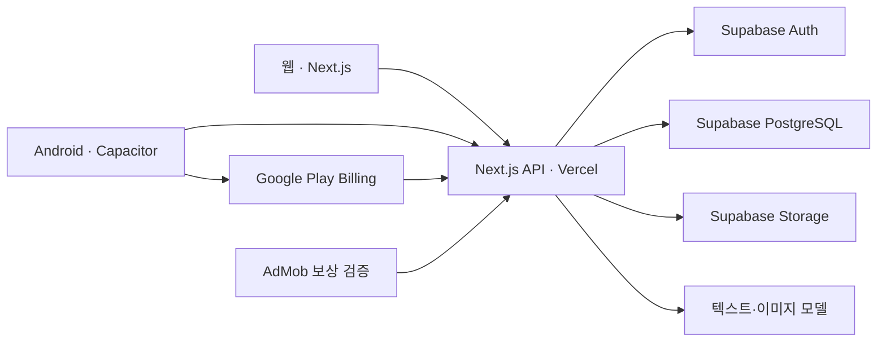

# MAITE 프로젝트 기획서

| 항목 | 내용 |
| --- | --- |
| 작성 기준 | 2026년 11월 27일 작업 트리의 소스코드와 Supabase 마이그레이션 |
| 제품 | AI 캐릭터와 대화하고, 함께 만든 이야기를 연재하고, 캐릭터와 소설을 거래하는 창작 서비스 |
| 제공 환경 | 웹과 Android 앱 |
| 주요 대상 | 캐릭터와 세계관을 직접 만들고 싶은 이용자, 역할극이나 연재 소설을 즐기는 독자, 결과물을 판매하고 싶은 창작자 |

## 1. 개발 의도

MAITE는 이름과 성격, 외형, 관계, 짧은 콘셉트만으로 사용자가 자기 캐릭터의 이야기를 시작할 수 있도록 만든 서비스다. 설정을 직접 짜는 재미는 살리면서 대사, 장면 구성, 원고 집필, 삽화 제작에 드는 작업을 AI가 돕는다. 회차별로 결과를 확인하고, 새 콘셉트를 보태며, 같은 캐릭터와 다른 방향의 이야기를 만들어 갈 수 있다.

캐릭터는 대화 상대이자 소설의 등장인물이다. 대화에서 쌓인 중요한 약속이나 관계 변화는 다음 이야기의 소재가 되고, 소설에서 확인된 사건은 이후 대화의 맥락이 될 수 있다. 이 연결을 바탕으로 사용자가 하나의 캐릭터를 오래 키우고, 연재와 갤러리로 결과를 쌓도록 설계했다. 서점에서는 제작자가 공개한 캐릭터와 소설을 구입해 같은 세계관을 즐길 수 있다. [캐릭터 제작 화면](components/CharacterStudio.tsx) · [대화·소설 연속성 설계](docs/CHAT_NOVEL_CONTINUITY.md)

이 문서는 이용자용 캐릭터·소설 서비스인 `/ideal`을 다룬다. 저장소에는 별도의 CAD 기술 검증 화면도 있다. [프로젝트 소개](README.md)

## 2. 이용자와 서비스 흐름

| 이용자 | 주로 하는 일 | 흐름 |
| --- | --- | --- |
| 창작자 | 캐릭터 제작, 대화, 연재, 삽화 생성, 작품 판매 | 로그인 → 캐릭터 생성 → 대화·소설 집필 → 서고에서 관리 → 표지 선택 후 판매 등록 |
| 독자·구매자 | 캐릭터와 대화하거나 연재를 읽고 갤러리 열람 | 서점 탐색 → 캐릭터 또는 회차 구매 → 소유 목록에서 이용 → 다음 회차 열람 또는 구매 |
| 운영자 | 이용 문의 답변, 공지 발행, 정산 처리 | 관리자 권한으로 문의와 요청 조회 → 답변 또는 송금 처리 → 공지 및 완료 상태 반영 |

하단 메뉴는 **캐릭터, 서고, 서점, 스토어, 내 정보**로 구성한다. 캐릭터 메뉴는 생성과 대화의 출발점이며, 서고는 소유한 소설과 구매한 콘텐츠를 열람하고 판매를 관리하는 곳이다. 서점은 다른 창작자의 판매 콘텐츠를 발견하는 곳이고, 스토어와 내 정보는 각각 하트 충전과 계정·보상·운영 기능을 맡는다. [하단 메뉴](components/AppFooter.tsx) · [서고](components/Bookshelf.tsx) · [계정 및 서점 화면](components/AccountPages.tsx)

## 3. 주요 기능

| 기능 | 현재 구현 |
| --- | --- |
| 캐릭터 생성 | 이름, 나이, 성별, 외형과 의상, 성격, 재미 요소, 콘셉트로 캐릭터를 만든다. 화풍은 부드러운, 화려한, 또렷한, 귀여운 중 선택하거나 무작위로 정한다. 후속 대화 이미지와 삽화에서 저장된 화풍을 활용한다. |
| 역할극 대화 | 캐릭터의 성격과 관계에 맞는 응답을 스트리밍한다. 대화에서 확인된 사건, 관계, 약속을 캐릭터별 상태에 기록하며 소설과 공유한다. |
| 연재 소설 | 콘셉트의 방향을 5회차에 걸쳐 발단·전개·위기·절정·결말로 설계한다. 각 회차도 다섯 사건을 바탕으로 집필한다. 전체 완결을 요청한 경우 그 의도를 반영하고, 그 외에는 해당 구간의 갈등을 마무리하며 후속 회차의 여지를 남긴다. 콘셉트에 별표로 지정된 필수 사건은 배치와 반영 여부를 추적한다. |
| 이미지와 삽화 | 대화에서 장소와 의상을 확인해 이미지를 생성할 수 있고, 소설에서는 장면의 인물과 구도를 지정해 회차에 연결한다. 생성 이미지는 세로 9:16으로 저장하며, 서고와 갤러리에서 열람할 수 있다. |
| 소설 열람 | 읽던 회차를 기억하고 이전·다음 회차로 이동한다. 해당 회차 삽화가 없으면 이전 회차의 삽화나 캐릭터 기본 이미지로 배경을 채운다. 다음 회차를 아직 구매하지 않은 독자는 구매 확인 후 바로 해당 회차를 열 수 있다. |
| 작품 관리와 거래 | 창작자는 갤러리에서 표지를 선택해 공개하고 판매 상태를 바꿀 수 있다. 연재 중에도 회차를 판매할 수 있다. 구매자는 구매한 회차와 함께 제공된 이미지를 열람할 수 있으며, 원작의 후속 회차를 추가하는 권한은 창작자에게 있다. 소설의 사용자 역할로 지정된 이름에는 구매자 닉네임을 반영할 수 있다. |
| 안부 메시지 | 마지막 대화 후 24시간이 지나면 캐릭터별 하루 한 번 안부를 보낼 수 있다. 이전 안부에 답장이 오기 전까지는 재발송을 제한한다. 안 읽은 안부는 캐릭터 메뉴에 표시하며, 알림과 야간 제한은 계정에서 관리한다. 야간 제한은 한국 시간 오후 10시부터 오전 10시까지다. |
| 보상과 운영 | 당일 출석·패스 보상이 남아 있으면 로그인 후 보상 화면으로 안내한다. 이용자는 공지사항, 문의 내역과 답변, 정산 상태를 확인하고 정산일 전에는 접수한 요청을 취소할 수 있다. |

[화풍 기준](lib/characters/render-style.ts) · [대화 화면](components/LiveChat.tsx) · [소설 생성](lib/novel/generate.ts) · [거래 API](app/api/store/route.ts) · [알림 로직](lib/notifications/local-checkins.ts) · [보상 진입](components/AccountProvider.tsx)

### 소설 생성과 이어 쓰기

1. 현재 콘셉트와 캐릭터 설정, 이전 회차, 대화에서 확인된 주요 사건과 약속을 모은다. 유효한 5회차 설계가 있으면 재사용하고, 새 설계가 필요하면 다음 구간의 방향을 정한다.
2. 이번 회차의 사건을 설계하고 본문을 집필한다. 지원하는 모델과 호출 방식에서는 집필 중 원고를 미리 보여 준다. 미리보기와 저장된 확정 원고는 별도로 처리한다.
3. 설정에 따라 문체 편집과 문맥·단어 교정을 거치고, 전개 검증에서 콘셉트 반영, 시간·장소·소품의 연속성, 사건 반복, 말투와 약속을 확인한다. 수정 가능한 문제는 해당 대사, 서술이나 사건을 중심으로 보정한다.
4. 최종 저장 기준을 통과하면 확정 회차를 저장한다. 소스의 최소 분량 기준은 1,500자다. 중간 원고나 완료된 단계가 체크포인트에 남아 있으면 재시도 때 활용한다.
5. 작성자가 특정 회차에서 뒤 이야기 삭제를 실행하면 그 회차까지 보존하고 후속 회차를 정리한다. 기존 삽화는 회차 연결이 해제되더라도 갤러리에서 열람할 수 있게 관리한다.

[집필 규칙](novel_prompt.md) · [생성 및 검증 코드](lib/novel/generate.ts) · [분량·체크포인트](lib/novel/checkpoint.ts) · [회차 삭제 후 삽화 보존](supabase/migrations/202611250002_preserve_rewound_illustrations.sql)

## 4. 기술 구성

### 프론트엔드

웹은 Next.js App Router, React, TypeScript를 사용한다. Android는 Vite와 Capacitor로 패키징하며 React 화면과 스타일을 공유한다. 모바일에서 캐릭터와 긴 소설 본문을 쉽게 읽도록 이미지, 갤러리, 입력창과 하단 메뉴를 중심으로 구성한다. 대화와 소설 초고는 서버 이벤트를 이용해 진행 상태를 표시한다. 로컬 읽기 위치와 이미지 캐시를 통해 화면을 오갈 때 같은 콘텐츠를 다시 받는 비용을 줄인다. [웹 레이아웃](app/ideal/layout.tsx) · [Android 진입점](apps/mobile/src/main.tsx) · [이미지 캐시 설계](docs/IMAGE_CACHE_NAVIGATION.md)

### 백엔드와 외부 서비스

| 영역 | 담당 |
| --- | --- |
| 로그인과 접근 제어 | Supabase Auth로 로그인한다. 서버 API가 세션과 요청 주체를 확인하고, 소유자·구매자·운영자 권한에 따라 읽기와 쓰기를 제한한다. |
| AI 생성 | `/api/characters`는 캐릭터와 이미지, `/api/chat`은 대화와 소설 생성 요청을 처리한다. `/api/generations`에서 생성 작업 상태를 확인한다. 텍스트 집필, 교정과 검수에 사용할 모델과 API 경로를 구성할 수 있다. |
| 작품과 파일 | `/api/account`가 계정 문서와 관련 이미지를 제공하고 `/api/store`가 판매 목록과 주문을 관리한다. 원본 이미지는 비공개 버킷에 두고 권한을 확인한 뒤 접근 URL을 발급한다. |
| 결제와 보상 | `/api/billing`에서 Google Play 상품 구매를 검증한다. `/api/ads/ssv`는 광고 보상 콜백을 검증하며 `/api/rewards`는 출석과 패스 일일 보상을 처리한다. |
| 운영 | `/api/notifications`는 안부 일정과 읽음 상태, `/api/support`는 문의·답변, `/api/notices`는 공지, `/api/settlements`는 정산 접수·취소·완료를 처리한다. Android는 동기화한 일정으로 기기 알림을 예약하고, 웹은 화면이 실행되는 동안 안부를 동기화한다. |

생성 작업에는 요청 식별자와 하트 예약을 사용한다. 결과를 저장하는 정상 완료 경로에서 차감을 확정하고, 실패하면 예약을 해제한다. 결제·광고 콜백과 재시도 요청은 거래 식별자와 DB 제약으로 중복 반영을 방지한다. 이용자의 하트 차감과 AI 공급사의 사용료 청구는 별도이므로 생성 실패에도 공급사 비용이 발생할 수 있다. 운영 시에는 단계별 처리 시간, 모델 사용량, 오류 코드를 서버 로그에서 확인한다. [API 디렉터리](app/api) · [Android 계정·결제 구성](docs/ANDROID_ACCOUNT_SETUP.md) · [생성 하트 예약 정책](supabase/migrations/202611180001_deferred_billing_and_character_delete.sql)

## 5. 데이터베이스와 저장소

Supabase PostgreSQL에 계정, 소유권, 생성 상태와 거래를 저장한다. 사용자별 캐릭터·대화·소설처럼 형태가 다른 데이터에는 `documents`의 JSONB 문서를 활용한다. 잔액, 거래, 지급처럼 제약과 일관성이 필요한 데이터는 별도 테이블과 DB 함수로 관리한다.

| 영역 | 주요 테이블·저장소 | 용도 |
| --- | --- | --- |
| 계정 | `auth.users`, `profiles` | 로그인 주체와 공개 닉네임 등 프로필 관리 |
| 작품 | `documents`, `story_rewind_backups` | 캐릭터·대화·소설과 연속성 상태 저장, 후속 회차 삭제 시 백업 |
| 이미지 | Supabase Storage `maite-private` | 캐릭터 이미지, 대화 이미지, 삽화와 썸네일의 파일 저장. 문서나 판매 스냅샷에서 경로를 참조 |
| 생성 | `generation_jobs`, `story_draft_checkpoints`, `image_generation_checkpoints` | 생성 요청, 예약·완료 상태, 저장 가능한 중간 결과와 재시도 관리 |
| 지갑과 결제 | `wallets`, `heart_ledger`, `payment_purchases`, `ad_reward_claims` | 빨간·파란 잔액과 무료 대화 횟수, 지급·소비 이력, 결제 검증 및 광고 보상 |
| 출석과 패스 | `daily_claims`, `heart_passes`, `pass_reward_periods` | 날짜별 수령 여부, 보유 패스와 과거 지급 가능 기간 관리 |
| 서점 | `store_listings`, `store_orders` | 공개 여부와 표지, 판매 시점 콘텐츠, 구매자와 이용 권한 기록 |
| 안부 | `notification_preferences`, `character_activity`, `character_checkins` | 설정, 마지막 활동, 발송·읽음과 답장 추적 |
| 운영 | `support_inquiries`, `support_replies`, `notices`, `heart_settlements` | 문의와 공지, 정산 신청 정보 및 취소·완료 상태 관리 |

작품 소유권과 구매 권한은 별개다. 판매 등록 시 작품 내용과 공개 이미지 범위를 기록해 두고, 구매 내역을 기준으로 이미 구입한 콘텐츠의 접근을 유지한다. 원작의 판매 중지와 새 이미지 생성은 이후 판매 범위에 반영되는 동작으로 관리한다. 자료 조회에 쓰는 권한과 DB 함수 호출 권한에는 행 수준 보안과 서버 검사를 적용한다. 정산 계좌 정보는 신청자와 담당 운영자의 조회 범위에 둔다. [계정·소유권 기본 스키마](supabase/migrations/202611170001_accounts.sql) · [판매 이미지 범위](lib/server/listing-media.ts) · [마이그레이션 디렉터리](supabase/migrations)

## 6. 비즈니스 모델

MAITE는 유료 하트와 하트 패스 판매로 매출을 만들고, 보상형 광고로 무료 이용 경로를 넓힌다. 사용자는 하트로 대화·소설·이미지를 생성하거나 다른 창작자의 작품을 구매한다. 창작자는 거래에서 받은 정산 가능 하트를 정산할 수 있다. 판매 수수료는 하트 거래에서 차감되며, 현금 매출과는 별도로 관리해야 한다.

### 판매 상품과 무료 보상

| 상품 | 가격 | 지급량 |
| --- | ---: | --- |
| 하트 150개 | 2,000원 | 구매 시 150개 |
| 하트 400개 | 5,000원 | 구매 시 400개 |
| 하트 1,000개 | 10,000원 | 구매 시 1,000개 |
| 하트 패스 | 5,000원 | 즉시 200개 + 30일간 일일 20개, 최대 800개 |

첫 가입 시 파란 하트 100개와 무료 대화 5회를 제공한다. 출석은 평일과 토요일 5개, 일요일 15개를 당일에 직접 수령한다. 패스 일일 보상은 유효 기간에 해당하는 이전 날짜분도 수령할 수 있다. Android 보상형 광고는 검증된 시청당 파란 하트 5개를 지급한다. [하트 상품과 생성 단가](lib/account/policy.ts) · [가입 보상](supabase/migrations/202611250003_signup_hearts.sql) · [출석·패스 수령](supabase/migrations/202611180006_library_rewards_story_cost.sql) · [광고 보상 검증](lib/server/admob.ts)

### 하트 사용과 거래

| 항목 | 이용자 차감 | 판매자 수수료 | 판매자 지급 |
| --- | ---: | ---: | ---: |
| 캐릭터 생성 | 50 | — | — |
| 대화 1회 | 무료 대화 소진 후 2 | — | — |
| 소설 1회차 생성 | 10 | — | — |
| 대화 이미지 생성 | 30 | — | — |
| 소설 삽화 생성 | 50 | — | — |
| 캐릭터 구매 | 30 | 5 | 25 |
| 소설 1회차 구매 | 10 | 2 | 8 |

빨간 하트는 정산 가능 잔액이며 파란 하트는 가입, 출석, 광고 등으로 받는 정산 불가 잔액이다. 생성과 구매는 두 잔액을 합쳐 결제할 수 있고 파란 하트부터 사용한다. 판매 수익은 결제에 사용된 하트 종류와 수수료를 반영해 지급한다. 구매자에게는 표의 가격이 적용되며 판매 수수료는 판매자 몫에서 차감한다. [구매 수수료 정책](supabase/migrations/202611260001_remove_store_buyer_fees.sql) · [이중 잔액과 정산 규칙](supabase/migrations/202611260003_heart_settlements.sql)

### 창작자 정산

매월 10일을 정산일로 하며, 빨간 하트 500개당 1,000원으로 계산한다. 사용자는 정산 월, 신청 하트, 은행·계좌·예금주 정보와 개인정보 제공 동의를 제출한다. 접수 시 정산할 하트를 차감하고 정산일 전에 취소하면 돌려준다. 운영자는 송금 후 요청을 완료로 변경하고, 사용자는 신청 이력에서 완료 상태를 확인한다. [정산 화면](components/SettlementScreen.tsx) · [정산 취소](supabase/migrations/202611260004_settlement_cancellation_and_notices.sql) · [정산 완료](supabase/migrations/202611270001_settlement_completion.sql)

## 7. 출시와 운영 계획

| 우선순위 | 확인할 흐름 | 확인 기준 |
| --- | --- | --- |
| 1. 첫 이용과 생성 | 로그인 → 가입 보상 → 캐릭터 생성 → 대화 → 첫 회차 집필 | 첫 결과까지 걸리는 시간, 생성 실패 후 재시도, 중복 하트 차감 여부를 확인한다. |
| 2. 결제와 거래 | Google Play 상품 구매 → 지갑 반영 → 서점 구매 → 갤러리 및 다음 회차 열람 | 콘솔의 상품명·가격·지급량을 앱과 대조하고, 결제 복원·환불 시 지갑과 구매 접근 상태를 확인한다. |
| 3. 정산과 운영 | 정산 요청·취소·송금·완료, 문의 답변과 공지 게시 | 접수 및 취소 시 잔액 일치, 사용자별 정보 접근, 담당자 처리 이력을 확인한다. |
| 4. 생성 비용과 품질 | 텍스트·이미지 공급사 장애, 생성 체크포인트, 이미지 조회와 캐시 | 결과물당 비용과 성공 시간, 재시도율, 이미지 전송량과 캐시 효과를 측정한다. |

초기에는 **가입 후 첫 캐릭터 생성률, 첫 대화에서 첫 소설로 이어지는 비율, 다음 회차 생성·구매율, 1일·7일 재방문율**을 본다. 운영 비용은 모델별 API 사용량, 이미지 저장·전송, 결제 수수료, 광고 수익과 창작자 지급을 함께 집계한다. 특히 성공한 결과물 한 건에 든 모델 비용에는 실패·재시도 호출도 포함해 생성 가격과 보상 정책의 근거로 삼는다.

표의 기능과 수치는 저장소 기준이다. 운영 환경의 DB 적용 상태, Google Play 상품 설정과 실제 서비스 지표는 배포·운영 점검에서 별도로 확인한다.
