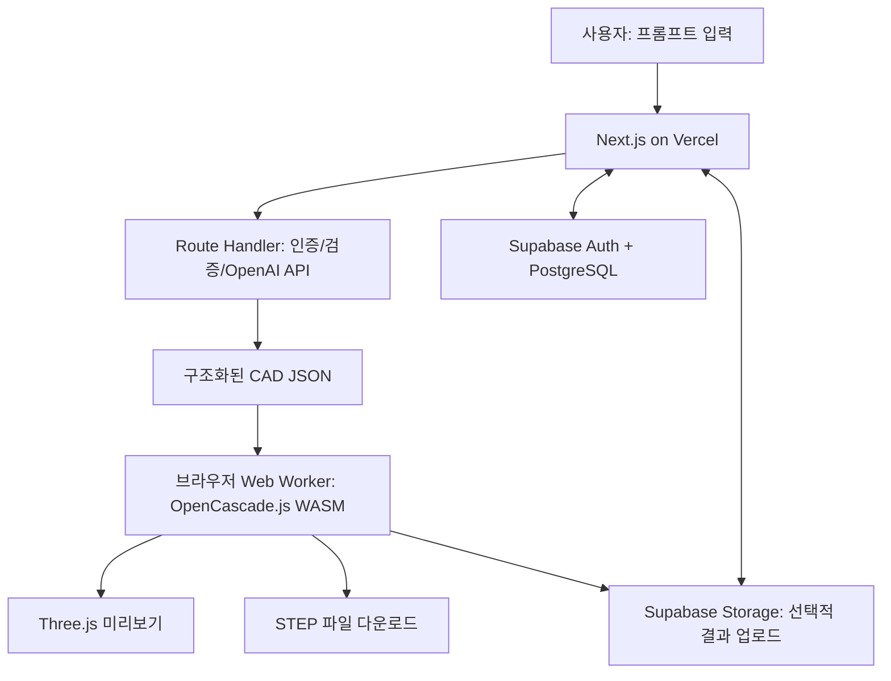

# Text to CAD — 서버리스 MVP 개발 명세

> **2026-11-15 화면 방향 정정:** 기본 화면은 캐릭터 생성(`/ideal`)이며 `/`에서 이동한다. 상단 모양 메뉴를 제거하고 대화(`/ideal/chat`)·이야기(`/ideal/story`)를 독립 페이지로 구성한다. 캐릭터 생성 결과는 클릭 시 전체화면으로 본다. 기존 CAD 기능은 `/technical/cad`의 기술 검증 범위로 유지한다. 최신 화면·동작 기준은 `agent.md`와 사용자 요청을 우선한다.

> **MVP 인증 범위 정정:** 사용자와 친구의 사업성 검토용으로 로그인·회원가입·공용 접근 코드 없이 이용한다. Supabase 인증은 구현 범위에서 제외하며 아래 기존 인증 요구보다 이 결정을 우선한다. 현재 실행에는 서버의 OpenAI 설정만 필요하다.

> **최종 방식 확정 (2026-11-14):** 사용자는 추가 3D 생성 AI 없이 **OpenAI → 제한된 형상 명세 → 브라우저 CAD 엔진 → 3D 미리보기 및 STEP 다운로드**를 선택했다. 주 화면은 채팅이며 후속 수정 대화를 지원한다. 기본 도형·곡면 조립으로 단순화한 외형을 생성하며, 실사 피규어 품질을 보장하지 않는다. Vercel + Supabase 인프라를 유지한다. 아래 이전 방향과 충돌 시 이 결정 및 `agent.md`를 우선한다.

> **2026-11-14 제품 방향 정정:** 사용자의 최신 요구는 채팅으로 ‘엎드려 자는 강아지’, ‘광화문 미니어처’ 등을 설명하면 프롬프트 최적화와 생성 API 호출을 거쳐, 대상의 특징이 살아 있는 피규어·미니어처의 3D 미리보기 및 STEP 다운로드를 제공하는 것이다. 아래의 단순 프리미티브 캐릭터/판재 우선 범위는 최종 제품 요구를 충족하지 않는다. 최신 우선순위는 `agent.md`의 ‘최우선 제품 요구’에 기록한다. 자유형상 3D 생성 엔진과 STEP 변환 품질은 별도 검증·선택이 필요하다.

> VS Code + Codex 작업용 프로젝트 컨텍스트 문서  
> 기준: 별도 CAD 서버 없이 **Vercel + Supabase**를 사용한다.

## 1. 프로젝트 목표

사용자가 자연어로 원하는 3D 형상을 설명하면 OpenAI API가 이를 **검증 가능한 CAD JSON 명세**로 변환한다. 브라우저에서 CAD 엔진(WebAssembly)을 실행하여 형상을 만들고 3D 미리보기와 STEP 파일 다운로드를 제공한다.

예시:
- 기계 부품: `100×60×5mm 판의 네 모서리에서 10mm 떨어진 위치에 지름 6mm 관통 구멍 4개를 만들어줘.`
- 캐릭터: `이브이가 엎드려 잠자는 모습을 길이 100mm로 만들어줘.`

**범위 구분:** 기계 부품은 정확한 B-Rep STEP을 목표로 한다. 캐릭터는 초기에는 단순 프리미티브 기반의 조형만 지원한다. 복잡한 캐릭터의 높은 외형 유사도나 편집 가능한 STEP 품질을 보장하지 않는다.

## 2. 확정된 제약과 기술 스택

| 영역 | 선택 |
|---|---|
| 웹 | Next.js (App Router), TypeScript |
| 스타일 | Tailwind CSS, shadcn/ui (선택) |
| 호스팅 | Vercel |
| 인증 / DB / 파일 | Supabase Auth / PostgreSQL / Storage |
| AI | OpenAI API, 서버 측 Route Handler에서 호출 |
| CAD | OpenCascade.js (OCCT WebAssembly), 브라우저 Web Worker |
| 미리보기 | Three.js / React Three Fiber |
| 작업 관리 | Supabase DB; 별도 Redis/RQ 없음 |

**사용하지 않음:** 별도 Python/FastAPI 서버, Docker Worker, Cloudflare R2, Redis/RQ.

주의: Vercel의 서버리스 함수는 OpenAI 호출·인증·메타데이터 관리에 사용하고, 무거운 CAD 연산은 브라우저에서 실행한다. OpenAI 키는 브라우저에 노출하지 않는다.

## 3. 아키텍처



- 브라우저 탭이 닫히면 로컬 CAD 작업이 중단될 수 있다.
- 작업 진행률은 브라우저 로컬 상태를 우선 사용한다. DB에 저장된 상태는 브라우저 종료 후 자동 복구를 보장하지 않는다.
- 생성된 파일을 Storage에 업로드해야 다른 기기에서 다시 다운로드할 수 있다.
- Supabase Storage에는 사용자별 접근 정책(RLS 및 경로 권한)을 적용한다.

## 4. 핵심 파이프라인

1. 사용자가 프롬프트, 모델 유형(auto/mechanical/character), 크기 및 출력 형식을 입력한다.
2. Next.js Route Handler가 사용자 인증, 요청 크기 및 사용량 제한을 검사한다.
3. OpenAI Structured Outputs로 제한된 CAD 명세(JSON)를 생성한다.
4. Zod 스키마로 JSON을 검증하고 허용된 연산만 전달한다.
5. 브라우저 Web Worker에서 OpenCascade.js를 초기화하고 B-Rep을 구성한다.
6. 메시로 테셀레이션하여 Three.js에서 미리보기한다.
7. OCCT STEP 내보내기로 `.step`을 생성하고 브라우저 다운로드를 제공한다.
8. 선택적으로 STEP/GLB 및 명세를 Supabase Storage/DB에 저장한다.

**중요한 기술 검증 게이트:** OpenCascade.js의 배포판/커스텀 WASM 빌드가 STEP writer 관련 OCCT 기능을 포함하는지 먼저 확인한다. 이를 확인하지 않고 STEP 다운로드 기능이 구현 가능하다고 가정하지 않는다. 생성한 STEP은 FreeCAD 등에서 다시 열어 유효성을 검사한다.

## 5. CAD JSON DSL 초안

AI가 임의 JavaScript/Python 코드를 생성해 실행하도록 하지 않는다. 우선 다음처럼 제한된 명세를 사용한다.

```json
{
  "schemaVersion": "1.0",
  "modelType": "mechanical",
  "unit": "mm",
  "operations": [
    { "id": "base", "type": "box", "size": [100, 60, 5], "center": [0, 0, 0] },
    { "id": "hole1", "type": "cylinder_cut", "target": "base", "radius": 3, "depth": 5, "center": [-40, -20, 0] }
  ],
  "outputs": ["step"]
}
```

위 구조는 **설계 예시**이며 실제 JSON Schema, 연산 순서, 좌표계, 구멍 관통 방향과 공차는 PoC에서 확정한다. MVP 허용 연산: box, cylinder, union, subtract, translate; fillet/chamfer는 후순위.

캐릭터는 머리·몸통·귀·꼬리 등을 기본 도형으로 조합하는 별도 scene graph 스키마를 사용한다. 캐릭터 STEP은 형상 변환 검증을 통과한 경우에만 제공한다.

## 6. DB 최소 설계

### `generations`

| 컬럼 | 타입 | 용도 |
|---|---|---|
| id | uuid PK | 생성 ID |
| user_id | uuid | Supabase Auth 사용자 |
| prompt | text | 사용자 입력 |
| model_type | text | auto/mechanical/character |
| resolved_type | text nullable | 분석된 형상 유형 |
| status | text | requested/spec_ready/generating/completed/failed |
| specification | jsonb nullable | 검증된 CAD 명세 |
| error_message | text nullable | 오류 메시지 |
| created_at | timestamptz | 생성 시각 |
| updated_at | timestamptz | 수정 시각 |

### `generation_files`

| 컬럼 | 타입 | 용도 |
|---|---|---|
| id | uuid PK | 파일 ID |
| generation_id | uuid FK | 생성 작업 |
| format | text | step/glb/stl |
| storage_path | text | Supabase Storage 경로 |
| size_bytes | bigint | 파일 크기 |
| created_at | timestamptz | 생성 시각 |

- 사용자별 RLS 정책을 적용한다.
- DB 상태는 원격 작업 큐의 상태가 아니다. 브라우저 작업 중단 시 `generating`이 남을 수 있으므로 UI에서 중단·재시작 흐름을 제공한다.
- 파일은 private bucket에 저장하고 권한 검증 후 signed URL을 발급한다.

## 7. 최소 API 명세

| Method | 경로 | 설명 |
|---|---|---|
| POST | `/api/generations` | 프롬프트 검증, OpenAI 호출, 명세 저장 |
| GET | `/api/generations` | 내 생성 이력 |
| GET | `/api/generations/:id` | 명세 및 상태 조회 |
| PATCH | `/api/generations/:id` | 브라우저 생성 상태 업데이트(소유권/상태 전이 검증) |
| POST | `/api/generations/:id/files` | 업로드 준비/메타데이터 등록; 실제 업로드 완료 확인 필요 |
| GET | `/api/generations/:id/files` | 다운로드 파일 목록 및 권한 검증 |

`POST /api/generations` 예시:

```json
{
  "prompt": "100x60x5mm 브라켓, 모서리에 6mm 구멍 4개",
  "modelType": "auto",
  "outputFormats": ["step"],
  "maxSizeMm": 150
}
```

성공 응답에는 `generationId`, `resolvedType`, `specification`을 반환한다. API는 STEP 바이너리를 생성하지 않는다. 인증, 입력 검증, 요청 제한, OpenAI 비용 제한 및 소유권 검사를 구현한다.

## 8. MVP 구현 순서와 완료 조건

### Phase 0 — STEP 내보내기 기술 검증 (최우선)
- [ ] Next.js 프로젝트 구성
- [ ] OpenCascade.js WASM을 브라우저 Web Worker에서 로딩
- [ ] 100×60×5mm 박스 생성
- [ ] 지름 6mm 관통 구멍 4개 Boolean cut
- [ ] STEP writer 기능 확인 및 `.step` 다운로드
- [ ] FreeCAD에서 열기, 치수/솔리드 검증

**완료 조건:** 생성된 STEP 파일을 CAD 프로그램에서 정상적으로 열고 치수를 확인할 수 있다. 실패 시 전체 설계에 앞서 WASM 빌드/대안 검토.

### Phase 1 — AI 명세 생성
- [ ] OpenAI API를 Next.js Route Handler에서 호출
- [ ] Structured Outputs + Zod 검증
- [ ] CAD DSL 연산 구현 및 에러 메시지
- [ ] 프롬프트 → 유효한 명세 → STEP 생성 연결

### Phase 2 — 3D UX
- [ ] Three.js 미리보기 및 카메라 조작
- [ ] Web Worker 진행 상태/오류/취소 처리
- [ ] STEP 다운로드, 파일명 처리
- [ ] 모바일/저사양 브라우저 제한 안내

### Phase 3 — Supabase
- [ ] Auth 로그인
- [ ] generations / generation_files 및 RLS
- [ ] Storage private bucket, 업로드/다운로드
- [ ] 생성 이력 및 작업 재시작 UI

### Phase 4 — 단순 캐릭터
- [ ] character scene graph 스키마
- [ ] 머리·몸통·귀·꼬리 등 프리미티브 조합
- [ ] GLB 미리보기 및 STL 출력 검토
- [ ] STEP 변환의 유효성/형상 품질 검증

### Phase 5 — 배포와 품질
- [ ] Vercel 배포 및 환경변수 설정
- [ ] 브라우저별 WASM 동작 테스트
- [ ] AI 요청 제한 및 오류 모니터링
- [ ] 테스트 프롬프트 세트와 회귀 테스트

## 9. 예상 프로젝트 구조

```text
text-to-cad/
├── app/
│   ├── page.tsx
│   ├── api/generations/route.ts
│   └── generations/[id]/page.tsx
├── components/
│   ├── PromptForm.tsx
│   ├── CadViewer.tsx
│   └── DownloadPanel.tsx
├── lib/
│   ├── ai/
│   │   └── generate-spec.ts
│   ├── cad/
│   │   ├── schema.ts
│   │   ├── interpreter.ts
│   │   └── step-export.ts
│   └── supabase/
├── workers/
│   └── cad.worker.ts
├── supabase/
│   └── migrations/
├── public/
│   └── wasm/
├── tests/
└── README.md
```

## 10. 주요 리스크

1. **STEP exporter 부재:** OpenCascade.js의 특정 WASM 빌드에 필요한 기능이 없을 수 있다. Phase 0에서 반드시 확인한다.
2. **캐릭터 품질:** 텍스트만으로 복잡한 캐릭터를 충실하게 만드는 것은 어렵다. MVP는 단순 조형으로 제한한다.
3. **브라우저 자원:** CAD WASM의 다운로드 크기, 메모리 사용량, 실행 시간이 클 수 있다.
4. **작업 지속성:** 탭 종료 시 로컬 생성 작업이 중단된다. 서버 백그라운드 처리와 동일하지 않다.
5. **비용:** 별도 CAD 서버는 없지만 Vercel, Supabase, OpenAI API 비용은 발생할 수 있다.
6. **보안:** AI 출력은 검증된 DSL만 해석한다. API 키를 클라이언트에 넣지 않는다.

## 11. Codex에 전달할 첫 작업 지시문

```text
이 저장소는 Vercel + Supabase만 사용하는 Text to CAD 서버리스 프로젝트다.
별도 Python 서버, Docker, Redis, Cloudflare를 도입하지 마라.

우선 Phase 0 기술 검증부터 구현해라.
1. Next.js + TypeScript 프로젝트를 준비한다.
2. OpenCascade.js의 실제 사용 가능한 패키지/API와 STEP writer 지원을 확인한다.
3. Web Worker에서 100x60x5mm 박스에 6mm 관통 구멍 4개를 생성한다.
4. 실제 .step 파일을 브라우저에서 다운로드한다.
5. README에 실행 명령, 제약, 검증 방법을 기록한다.

확인되지 않은 라이브러리 API를 추측해 작성하지 말고, 지원되지 않으면 원인과 대안을 명시해라.
Phase 0이 검증되기 전에는 Supabase DB나 캐릭터 기능을 구현하지 마라.
```

---

**설계 원칙:** 우선 브라우저에서 유효한 STEP 파일을 실제로 내보낼 수 있는지 검증한 뒤, AI·인증·저장·캐릭터 기능을 단계적으로 추가한다.
